# comfyui-colorfix-v3

ComfyUI custom node extension implementing the **tile_colorfix** algorithm from A1111's ControlNet extension. Supports both **SD/SDXL** and **Flux** models (Dev, Schnell, Klein and other Flux variants).

---

## Examples

| Reference | SDXL + ColorFix + ControlNet Tile | Flux + ColorFix + ControlNet + LoRA |
|:---------:|:---------------------------------:|:-----------------------------------:|
| 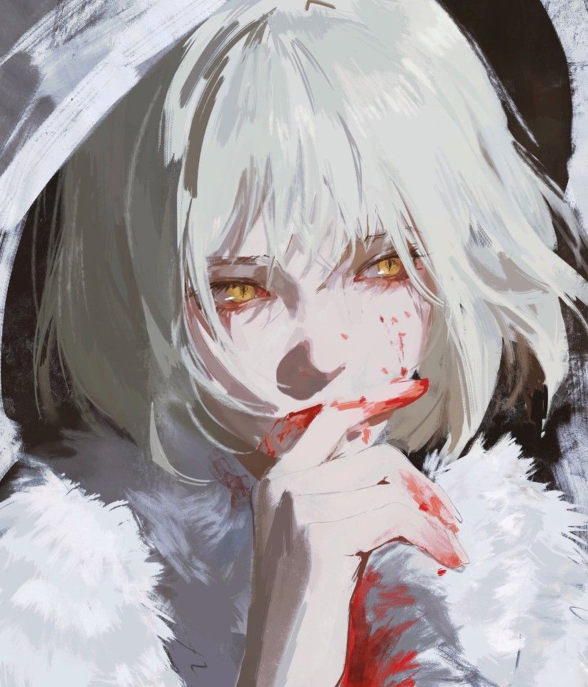 | 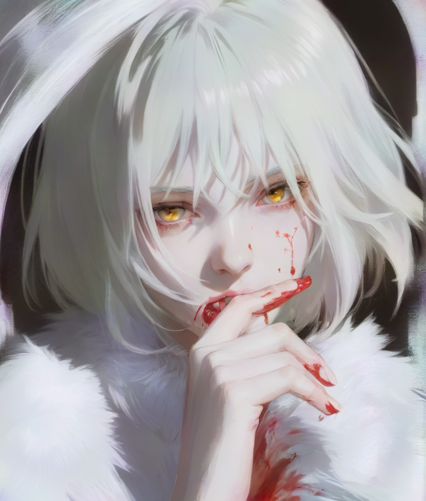 |  |
| Input reference image | txt2img XL + ColorFix + ControlNet + Tile | txt2img Flux + ColorFix + ControlNet + LoRA |

### ColorFix Effect Comparison

| SDXL: With vs Without ColorFix | Flux: With vs Without ColorFix |
|:------------------------------:|:------------------------------:|
|  |  |

### ControlNet Mode Comparison

| SDXL ControlNet Modes | Flux ControlNet Modes |
|:---------------------:|:---------------------:|
|  |  |

### Flux Blur Mode & Weight Test


### FLUX.3 Klein Tests

`blur_k` is a trade-off: smaller values transfer color more strongly but also leak the reference's structure; larger values leak less but transfer less color. Four references (painting, anime, two photos), same seed and settings:

| blur_k | Across all four tests |
|--------|-----------------------|
| `4` | Always leaks the reference's structure — in the photo tests it practically re-draws the reference |
| `8` | Strongest color, faint structure traces (tested on 1–2 only) |
| **`12`–`16`** | **Best range for tile mode:** full palette and no direct copying, but the pose, framing or layout can still drift toward the reference. Start at `12`; if traces of the reference still show, go to `16` |
| `24`–`32` | Color weakens and the composition drifts back toward the no-ColorFix result |

If the reference is a different picture and the model's own composition matters more than exact object colors, use [AdaIN mode](#keeping-the-models-geometry-adain) instead.

#### Test 1 — painterly portrait

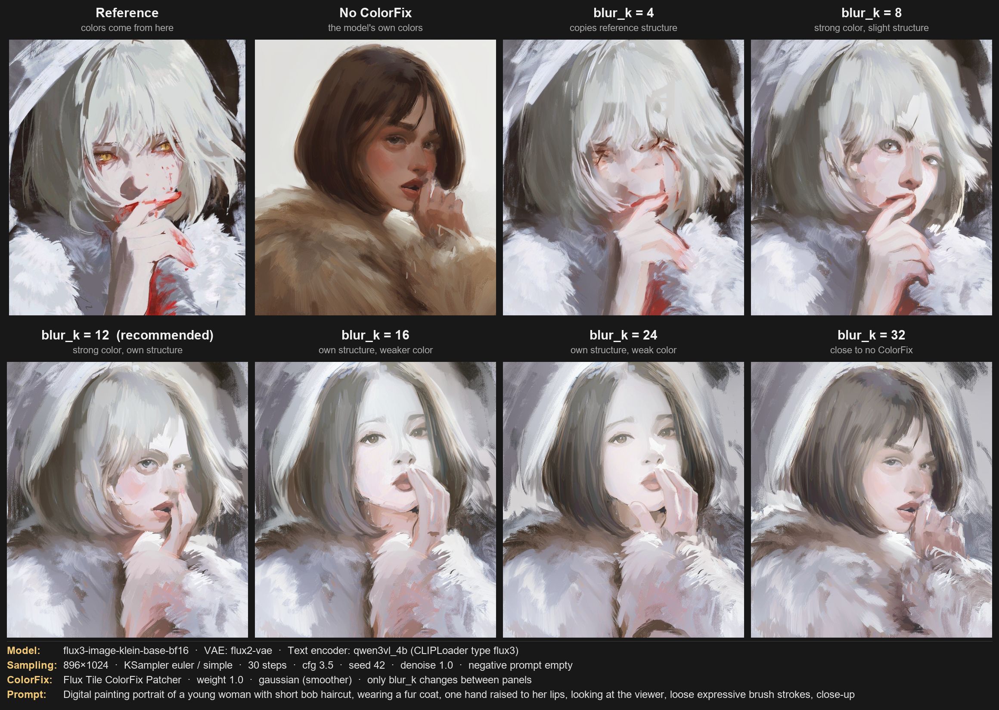

| Panel | What it is | Result |
|-------|------------|--------|
| Reference | `assets/reference.png`, resized to 896×1024 and VAE-encoded into `ref_latent` | White hair, grey/white palette, red accents, dark corners |
| No ColorFix | Plain generation, model goes straight into KSampler | Brown hair, beige fur, light background — the model's own colors |
| `blur_k = 4` | Model → **Flux Tile ColorFix Patcher** → KSampler | Too strong: copies the reference's structure (hair over the eyes, smeared face) |
| `blur_k = 8` | Same | Strong color transfer, some reference structure still shows through |
| `blur_k = 12` | Same | **Best balance in this test:** white hair and grey palette, face, pose and hand generated by the model |
| `blur_k = 16` | Same | No reference structure, but hair turns grey-brown; only fur and background keep the palette |
| `blur_k = 24` | Same | Like 16, color transfer weaker still |
| `blur_k = 32` | Same | Brown hair again, close to no ColorFix; palette only in fur and background |

**Settings shared by all generations:**

| Parameter | Value |
|-----------|-------|
| Diffusion model | `flux3-image-klein-base-bf16.safetensors` |
| VAE | `flux2-vae.safetensors` (used for both encoding the reference and decoding) |
| Text encoder | `qwen3vl_4b_int8_convrot.safetensors`, `CLIPLoader` type `flux3` |
| Latent | `EmptyFlux2LatentImage` 896×1024 |
| Sampler | `KSampler` euler / simple, 30 steps, cfg 3.5, seed 42, denoise 1.0 |
| ColorFix | `weight 1.0`, `blur_mode: gaussian (smoother)`; only `blur_k` changes between panels |
| Prompt | *Digital painting portrait of a young woman with short bob haircut, wearing a fur coat, one hand raised to her lips, looking at the viewer, loose expressive brush strokes, close-up* |
| Negative prompt | empty |

The prompt doesn't mention any colors, so every color difference from the "No ColorFix" panel comes from ColorFix. Reproduce with [`workflows/FLUX3_klein_colorfix_test_api.json`](workflows/FLUX3_klein_colorfix_test_api.json) (API format; put `reference.png` into ComfyUI's `input` folder first).

#### Test 2 — anime full body, flat color areas

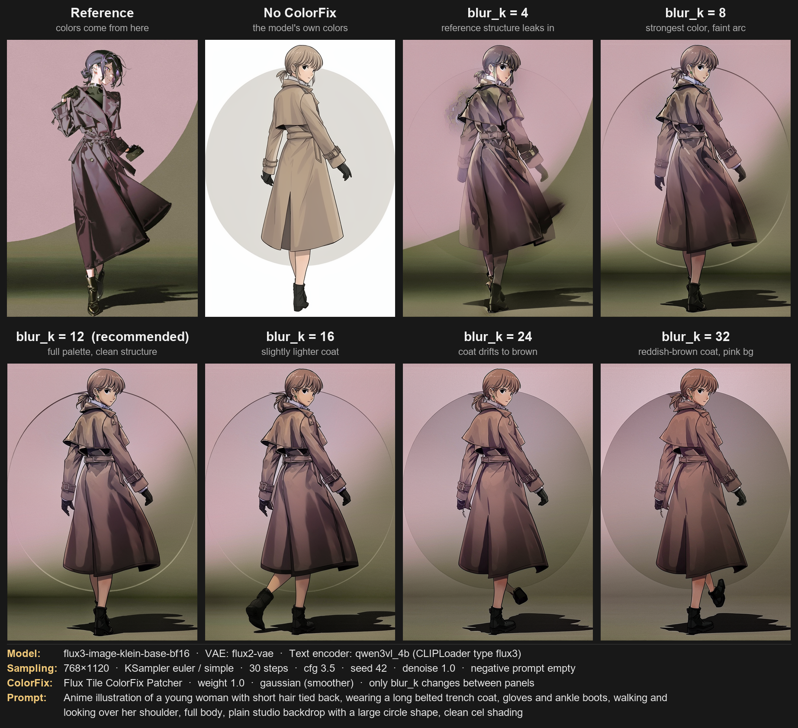

| Panel | Result |
|-------|--------|
| Reference | Plum trench coat, dark purple hair, pink backdrop with an olive arc, olive floor |
| No ColorFix | Beige coat, light hair, white backdrop with a grey circle |
| `blur_k = 4` | Structure leaks in: the reference's olive arc on the right, a blotch at the shoulder, a ghost hand at the waist |
| `blur_k = 8` | Strongest color (plum coat, darker hair, pink backdrop, olive floor), the reference arc only faintly visible |
| `blur_k = 12` | **Best balance:** full palette and the model's figure, but the backdrop follows the reference's pink-and-olive layout and the circle shrinks to a thin line |
| `blur_k = 16` | Same palette, coat slightly lighter |
| `blur_k = 24` | Coat drifts toward brown, backdrop stays pink |
| `blur_k = 32` | Reddish-brown coat, pink backdrop still there |

Same settings as Test 1 except: **768×1120**, reference `418421c125d9448d0d7d4714c9a8780f.jpg`, prompt *Anime illustration of a young woman with short hair tied back, wearing a long belted trench coat, gloves and ankle boots, walking and looking over her shoulder, full body, plain studio backdrop with a large circle shape, clean cel shading*.

Unlike Test 1, color carries over even at `blur_k = 32`: this reference is made of large flat color areas (backdrop, floor), which live almost entirely in the low frequencies that ColorFix transfers. References with more fine detail lose color faster as `blur_k` grows.

Reproduce with [`workflows/FLUX3_klein_colorfix_test2_api.json`](workflows/FLUX3_klein_colorfix_test2_api.json) (put the reference image into ComfyUI's `input` folder under that filename, or change the `LoadImage` node).

#### Test 3 — photo, single saturated color

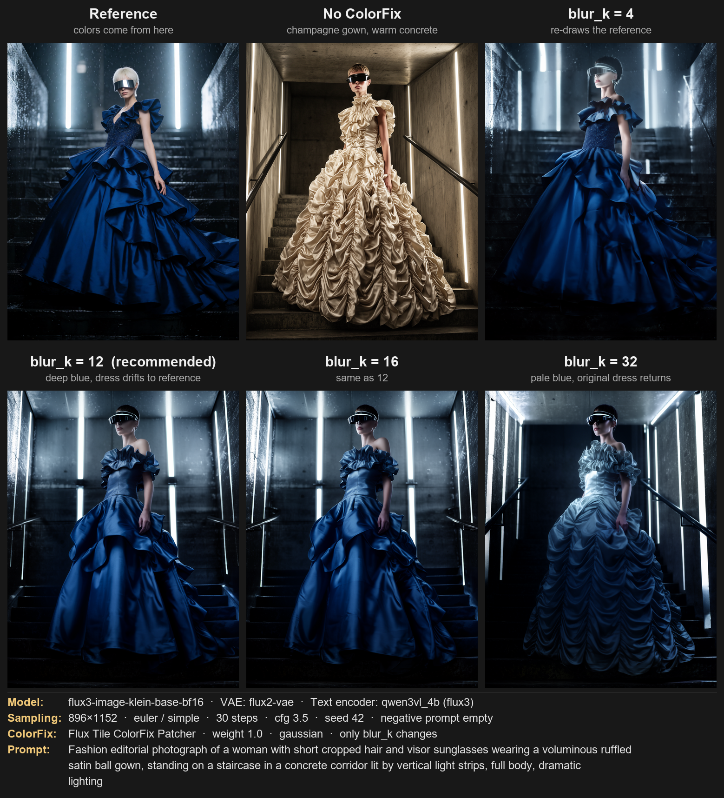

| Panel | Result |
|-------|--------|
| Reference | Royal-blue satin gown, dark wet stairs, cold vertical light strips |
| No ColorFix | Champagne ruched gown, warm concrete |
| `blur_k = 4` | Practically re-draws the reference: same pose, light strips and dress cut |
| `blur_k = 12` | **Best:** deep blue gown and cold blue corridor, no direct copying, but the tiered dress and back-wall light strips drift toward the reference |
| `blur_k = 16` | Nearly identical to 12 |
| `blur_k = 32` | Pale icy-blue gown; the no-ColorFix dress design comes back |

Reference `fashion_portrait_blue_silk_gown_vis.png`, 896×1152, prompt *Fashion editorial photograph of a woman with short cropped hair and visor sunglasses wearing a voluminous ruffled satin ball gown, standing on a staircase in a concrete corridor lit by vertical light strips, full body, dramatic lighting*. Workflow: [`workflows/FLUX3_klein_colorfix_test3_api.json`](workflows/FLUX3_klein_colorfix_test3_api.json).

#### Test 4 — photo, muted color on a gradient

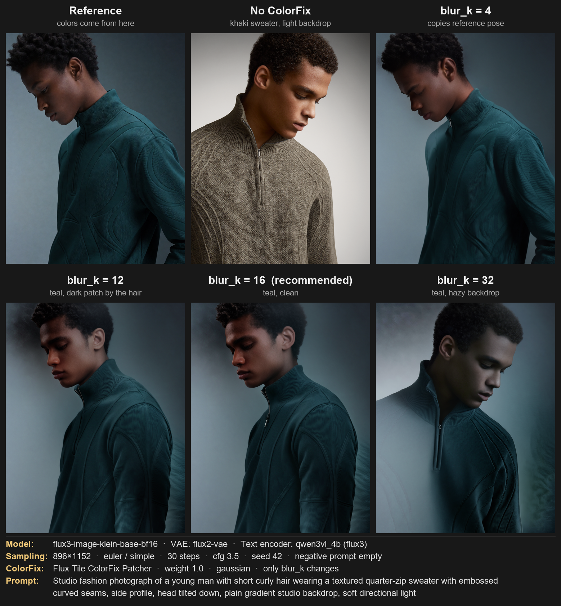

| Panel | Result |
|-------|--------|
| Reference | Teal quarter-zip sweater, grey-blue gradient backdrop |
| No ColorFix | Khaki knit sweater, light grey backdrop |
| `blur_k = 4` | Copies the reference's pose and framing |
| `blur_k = 12` | Teal sweater and gradient, but a dark patch by the hair — a trace of the reference's hair. The head still turns toward the reference's pose |
| `blur_k = 16` | **Best:** same palette, the patch is gone; the pose still follows the reference |
| `blur_k = 32` | Still teal, but the backdrop turns hazy and the left sleeve blends into it |

Reference `portrait_model_denim.png`, 896×1152, prompt *Studio fashion photograph of a young man with short curly hair wearing a textured quarter-zip sweater with embossed curved seams, side profile, head tilted down, plain gradient studio backdrop, soft directional light*. Workflow: [`workflows/FLUX3_klein_colorfix_test4_api.json`](workflows/FLUX3_klein_colorfix_test4_api.json).

Each test uses a single seed, so treat `12`–`16` as a starting range, not a fixed rule.

### Keeping the Model's Geometry: AdaIN

Tile mode transfers color by position: whatever was in the top left of the reference ends up in the top left of the result. That suits img2img and upscaling, where both share a composition. With an unrelated reference, the composition either follows the reference or the colors land in the wrong places.

`transfer_mode: adain (global)` on **Flux Tile ColorFix Patcher** matches each latent channel's overall mean and spread instead, so no position information from the reference is used:

```
x0_fixed = (x0_prd - mean(x0_prd)) / std(x0_prd) * std(x0_ref) + mean(x0_ref)
```

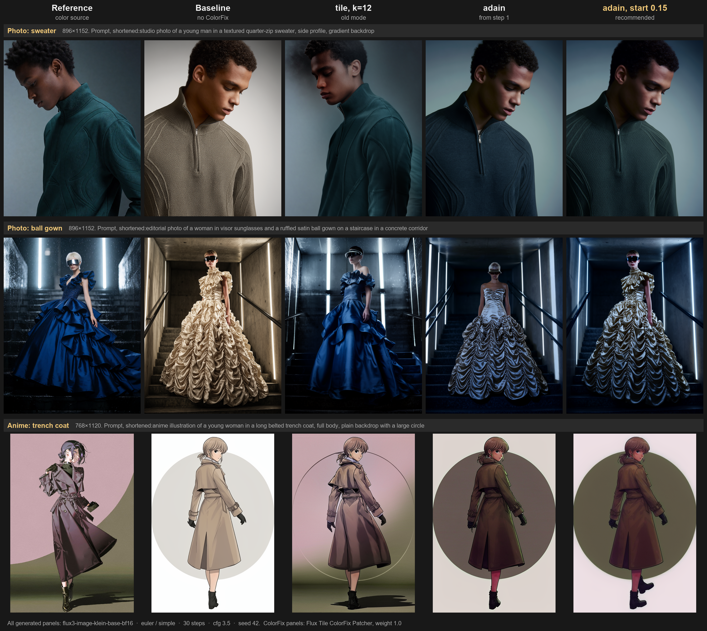

| Mode | Composition | Color |
|------|-------------|-------|
| `tile`, `blur_k` 12 | Pose, dress or backdrop layout drift toward the reference | Closest to the reference, including object colors: blue gown, plum coat |
| `adain`, from the first step | No reference silhouette or layout, but the image still changes: the gown's design differs from the no-ColorFix result | Overall palette only; gown turns silver-blue, coat brown |
| **`adain`, `start_percent` 0.15** | **Closest to the no-ColorFix result** of the modes compared; not identical (the anime figure's stride changes) | Recognizable palette, especially the anime backdrop. Object colors still don't follow the reference: the gown stays gold |

**Which to use:** `tile` when the reference and the output share a composition or exact object colors matter most; `adain` with `start_percent` around `0.15` when the reference is a different picture and the composition matters most; add [`tile_mix`](#hybrid-adain--tile-tile_mix) for a middle ground.

**AdaIN limitations:**
- It sets the palette of the whole frame, not what color each object gets, so a blue dress in the reference doesn't produce a blue dress. Color can land on the wrong things: the anime figure's legs turn crimson in the AdaIN panels here.
- `weight 0.7` gave mixed results: on the sweater it stayed closer to the no-ColorFix framing than `weight 1.0`, on the anime reference it mostly muted the color. Adding it to `start_percent 0.15` (anime only) changed little. `adain mean-only` shifts tone without matching contrast, and came out darker on both photo references.
- These results come from three references and a single seed, so treat them as a starting point.

Full grids: [sweater](assets/FLUX3_klein_colorfix_adain_sweater.png), [gown](assets/FLUX3_klein_colorfix_adain_gown.png), [anime](assets/FLUX3_klein_colorfix_adain_anime.png). Workflows: [`sweater`](workflows/FLUX3_klein_colorfix_adain_sweater_api.json), [`gown`](workflows/FLUX3_klein_colorfix_adain_gown_api.json), [`anime`](workflows/FLUX3_klein_colorfix_adain_anime_api.json). Prompts and references are the same as in Tests 2–4, with the same sampler settings.

#### Hybrid: AdaIN + tile (`tile_mix`)

`tile_mix` blends a share of tile transfer over the AdaIN result, so the palette comes from AdaIN and some color follows the reference's positions:

```
x0_fixed = adain + tile_mix * (tile(adain, blur_k) - adain)
```

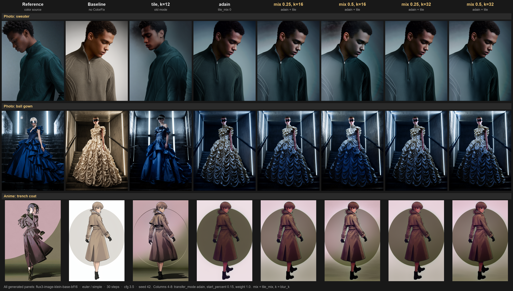

Compared with pure AdaIN, the model's pose and scene stay in place while object colors move toward the reference: the gown's skirt turns blue. The cost is faint traces of the reference's layout: part of the sweater goes pale where the reference's backdrop was light, and an olive band from the reference's floor crosses the anime backdrop.

| Setting | Effect |
|---------|--------|
| **`transfer_mode: adain`, `start_percent 0.15`, `tile_mix 0.5`, `blur_k 32`** | **Good starting point on all three models tested** |
| Lower `blur_k` (Klein `16`) | Stronger color, more traces of the reference, such as a dark cloud above the sweater |
| Lower `tile_mix` (`0.25`) | Closer to pure AdaIN, smaller effect |

Color still follows position in the frame, not objects. The gown's blue lands on the skirt because the reference's blue occupies a similar area; where the two layouts differ more, color can land on the wrong thing.

##### Other models

The same comparison on FLUX.1 Dev and an SDXL fine-tune. The new inputs live on **Flux Tile ColorFix Patcher**, and that node also runs on SDXL despite its name; the `tile` column here uses the standard **Tile ColorFix Patcher**.

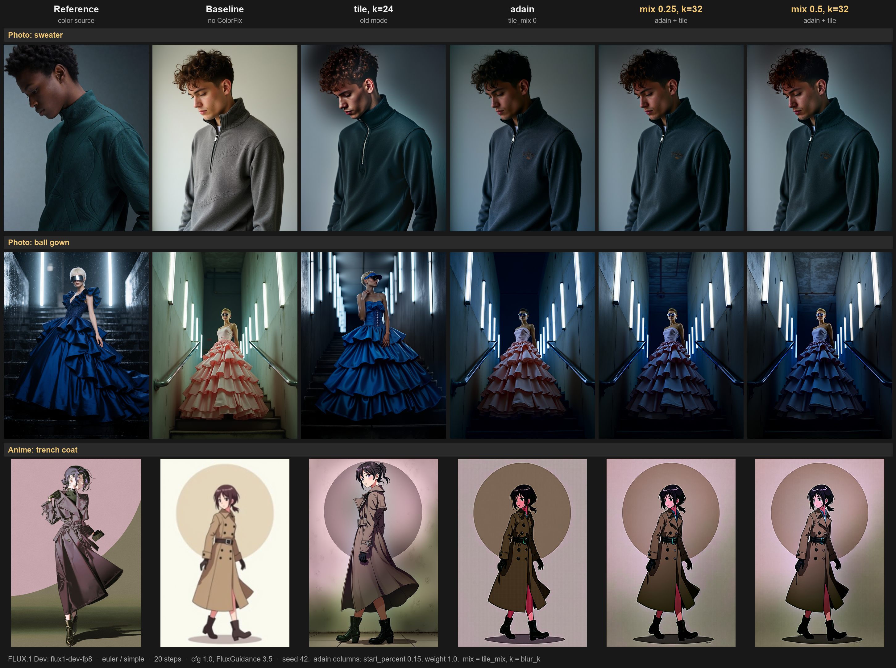

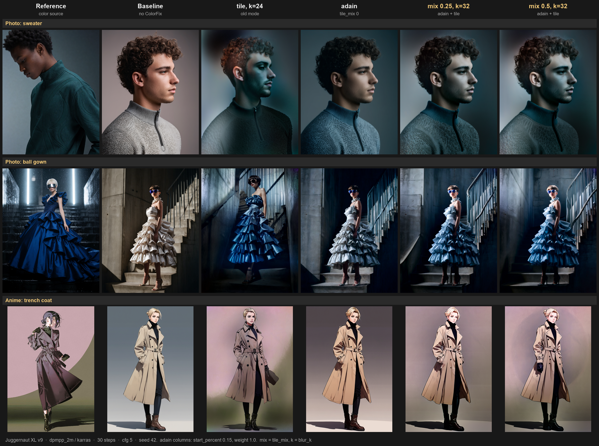

| Model | Settings | Result |
|-------|----------|--------|
| FLUX.1 Dev (`flux1-dev-fp8`) | euler / simple, 20 steps, cfg 1.0, FluxGuidance 3.5 | Same pattern as Klein. Weaker object color (the gown only reaches slate blue), and pure AdaIN gave bright artifacts on the anime figure: red face and legs. The hybrid fixed the face; the legs stayed red |
| Juggernaut XL v9 | dpmpp_2m / karras, 30 steps, cfg 5 | Same pattern. Best gown of the three models: blue dress in nearly the same scene as the no-ColorFix result. `adain` and the hybrid still change the lighting, and the sweater's face goes cooler with the hybrid |

**`blur_k` is measured in latent pixels, so the same value covers a different image area per model.** FLUX.1 and SDXL downscale by 8, Klein by 16: `blur_k 24` on these models covers about the same area as `blur_k 12` on Klein. The `blur_k` ceiling of `32` on FLUX.1 and SDXL therefore matches only `16` on Klein.

These runs use one seed and three references per model, and Juggernaut is the only SDXL model tested. Base SDXL, anime fine-tunes and SD 1.5 are untested. Workflows (API format):

| Reference | FLUX.3 Klein | FLUX.1 Dev | Juggernaut XL |
|-----------|--------------|------------|---------------|
| Sweater | [`workflow`](workflows/FLUX3_klein_colorfix_hybrid_sweater_api.json) | [`workflow`](workflows/FLUX1_dev_colorfix_hybrid_sweater_api.json) | [`workflow`](workflows/SDXL_juggernaut_colorfix_hybrid_sweater_api.json) |
| Gown | [`workflow`](workflows/FLUX3_klein_colorfix_hybrid_gown_api.json) | [`workflow`](workflows/FLUX1_dev_colorfix_hybrid_gown_api.json) | [`workflow`](workflows/SDXL_juggernaut_colorfix_hybrid_gown_api.json) |
| Anime | [`workflow`](workflows/FLUX3_klein_colorfix_hybrid_anime_api.json) | [`workflow`](workflows/FLUX1_dev_colorfix_hybrid_anime_api.json) | [`workflow`](workflows/SDXL_juggernaut_colorfix_hybrid_anime_api.json) |

#### Why not just delay tile mode?

`start_percent` and `blur_k_start` also work in tile mode, but on their own they don't solve this. On the sweater reference they kept the model's pose, while the reference's light background and dark figure appeared over it like a double exposure. `blur_k 4` with `start_percent 0.2` pulled the pose back toward the reference.

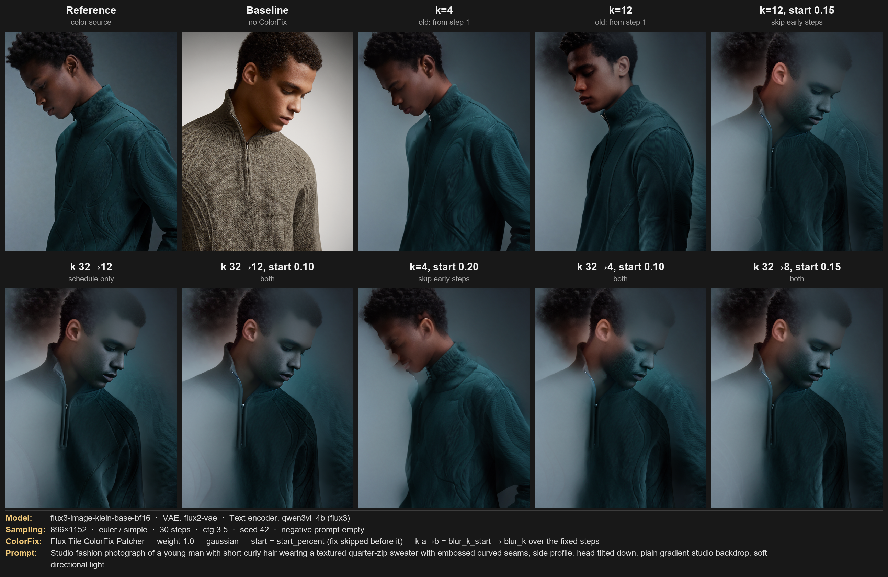

Workflow: [`workflows/FLUX3_klein_colorfix_geometry_api.json`](workflows/FLUX3_klein_colorfix_geometry_api.json).

---

## Nodes

### SD / SDXL

| Node | Description |
|------|-------------|
| `Tile ColorFix Patcher` | Patches the model to apply color correction at every denoising step. Transfers low-frequency color from a reference image while preserving AI-generated detail. |
| `Tile ColorFix+Sharp Patcher` | Same as above with additional detail enhancement via CFG sharpening. |
| `Apply Ultimate ControlNet` | Apply ControlNet with A1111-compatible control modes (balanced / prompt / control). |
| `Ultimate Multi-ControlNet Stack` | Build a stack of up to 3 ControlNets with per-slot on/off, strength, start/end percent, and control mode. |
| `Apply Ultimate Multi-ControlNet` | Apply a multi-ControlNet stack to conditioning (SD/SDXL). |

### Flux (Dev / Schnell / Klein)

| Node | Description |
|------|-------------|
| `Flux Tile ColorFix Patcher` | Base tile_colorfix for Flux models (FLUX.1 16-channel and FLUX.3 Klein 128-channel latents). Optional inputs add a global [AdaIN mode](#keeping-the-models-geometry-adain), an AdaIN + tile hybrid, and control over when the fix starts. |
| `Flux Tile ColorFix+Sharp Patcher` | Color correction + direct sharpening for Flux models. |
| `Apply Ultimate ControlNet (FLUX)` | Apply single ControlNet with Flux-adapted control modes. |
| `Apply Ultimate Multi-ControlNet (FLUX)` | Apply a multi-ControlNet stack to conditioning (Flux). |

> **Note:** The Flux nodes work with FLUX.1 (Dev, Schnell) and FLUX.3 Klein. The algorithm operates on latent tensors via ComfyUI's model patching API and does not depend on the channel count, so any Flux-based model that runs through KSampler is supported.
>
> FLUX.3 Klein uses the Flux2 latent format (128 channels, 16× spatial downscale vs 8× for FLUX.1). In tile mode, use `blur_k` `12`–`16` (start at `12`, raise to `16` if the reference's shapes still show through): lower values (`4`–`8`) pass the reference's structure along with its colors, `24`+ transfers less color. See the [FLUX.3 Klein tests](#flux3-klein-tests) above.

---

## Workflow 1 — SDXL + ColorFix + ControlNet + Tile

```
Load Image ──► VAE Encode ──► TileColorFixPatcher ──► KSampler
Load Checkpoint (SDXL) ───────────────────────────────────────► KSampler
                         ControlNetTileApply ──────────────────► KSampler
```

**Nodes used:**
- `Load Image` → `VAE Encode` → connect to `ref_latent` on **Tile ColorFix Patcher**
- `Load Checkpoint` → connect `MODEL` to **Tile ColorFix Patcher**
- **Tile ColorFix Patcher** → patched `MODEL` → **KSampler**
- `Load ControlNet` + `Load Image` → **Apply Ultimate ControlNet** → `CONDITIONING` → **KSampler**

**Key parameters:**
- `blur_k` — controls the color transfer radius (default `8`, range `3–32`)
- `weight` — color fix strength (`0.0` = none, `1.0` = full)
- `blur_mode` — `box (A1111 original)` for exact A1111 match, `gaussian` for smoother blending

---

## Workflow 2 — Flux (Dev / Schnell / Klein) + ColorFix + ControlNet + LoRA

```
Load Image ──► VAE Encode (Flux) ──► FluxTileColorFixPatcher ──► KSampler
Load Checkpoint (Flux) ─────────────────────────────────────────► KSampler
Load LoRA ──────────────────────────────────────────────────────► KSampler
```

**Nodes used:**
- `Load Image` → `VAE Encode` (Flux VAE) → connect to `ref_latent` on **Flux Tile ColorFix Patcher**
- `Load Checkpoint` → `Load LoRA` → connect `MODEL` to **Flux Tile ColorFix Patcher**
- **Flux Tile ColorFix Patcher** → patched `MODEL` → **KSampler**

**Key parameters:**
- Encode the reference with the VAE that matches the model: Flux VAE for FLUX.1 (16 channels), `flux2-vae` for FLUX.3 Klein (128 channels)
- `blur_k` and `weight` work the same as the SD/SDXL version

**Optional inputs on Flux Tile ColorFix Patcher** (existing workflows keep their behavior; tested on FLUX.3 Klein, FLUX.1 Dev and Juggernaut XL v9):
- `transfer_mode` — `tile (spatial)` (default), `adain (global)`, or `adain mean-only (global tone)`. With AdaIN, `blur_k`, `blur_mode` and `blur_k_start` apply only when `tile_mix` is above `0`
- `tile_mix` — AdaIN modes: share of tile transfer blended over the AdaIN result (default `0.0`, try `0.5` with `blur_k 32`)
- `start_percent` — skip the fix before this point of sampling (default `0.0`, try `0.15` with AdaIN)
- `blur_k_start` — start the tile radius here and move linearly to `blur_k` by the end (default `0` = constant `blur_k`)

---

## Installation

Clone into your ComfyUI `custom_nodes` folder:

```bash
cd ComfyUI/custom_nodes
git clone https://github.com/ihorpankin/comfyui-colorfix-v3.git
```

Restart ComfyUI. The nodes will appear under the `colorfix-v3` category.

---

## How It Works

The **tile_colorfix** algorithm splits an image into low-frequency (color/tone) and high-frequency (detail/texture) components using a blur kernel. At each denoising step, the low-frequency component of the generation is replaced with the low-frequency component of the reference image. This forces the model to match the color palette of the reference while still generating its own detail.

- **Low frequency** — extracted via box/gaussian blur
- **Color swap** — reference low-freq replaces generated low-freq
- **High frequency preserved** — AI-generated texture and detail remain untouched

This is a port of the original A1111 implementation to native ComfyUI model patching via `set_model_sampler_post_cfg_function`. The Flux patcher's optional [AdaIN mode](#keeping-the-models-geometry-adain) uses the same patching point but matches global statistics instead of swapping frequencies.

---

## Architecture

```
comfyui-colorfix-v3/
├── __init__.py           # Node registration
├── layer1_nodes/         # ComfyUI-visible nodes (model patchers)
│   ├── colorfix_patcher.py
│   ├── colorfix_sharp_patcher.py
│   ├── controlnet_apply.py
│   ├── controlnet_stack.py
│   ├── controlnet_multi_apply.py
│   ├── flux_colorfix_patcher.py
│   ├── flux_colorfix_sharp_patcher.py
│   ├── flux_controlnet_apply.py
│   └── flux_controlnet_multi_apply.py
└── layer2_core/          # Internal algorithm
    ├── blur.py           # Box / Gaussian blur kernels
    ├── color_swap.py     # Low-frequency color transfer, AdaIN
    └── sampler_callback.py  # Post-CFG callback factory
```
